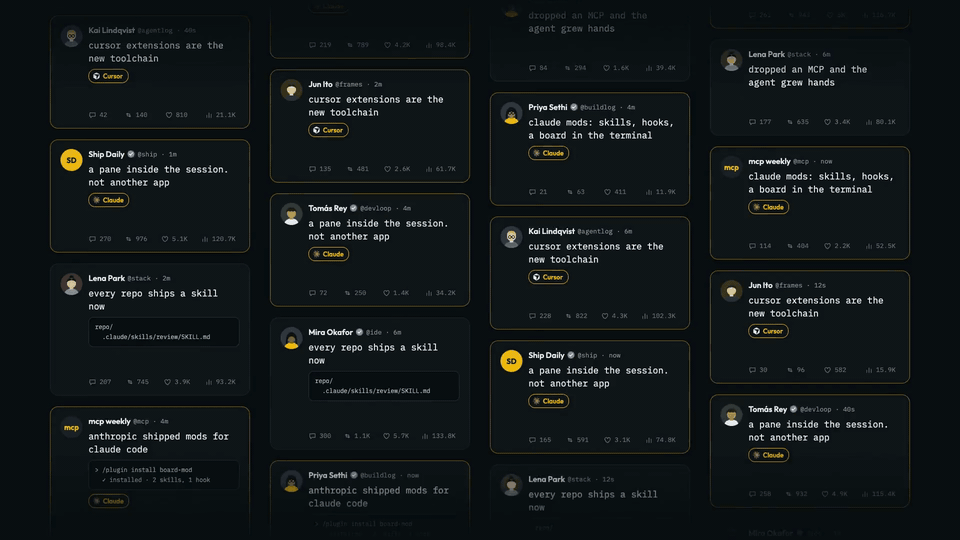
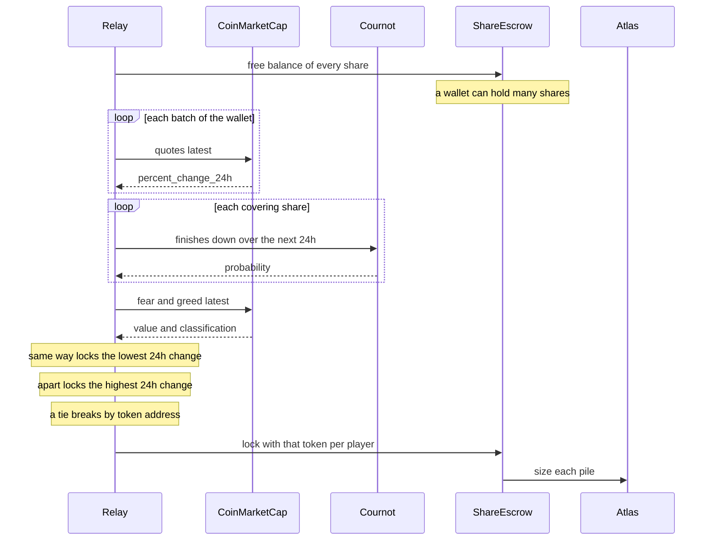
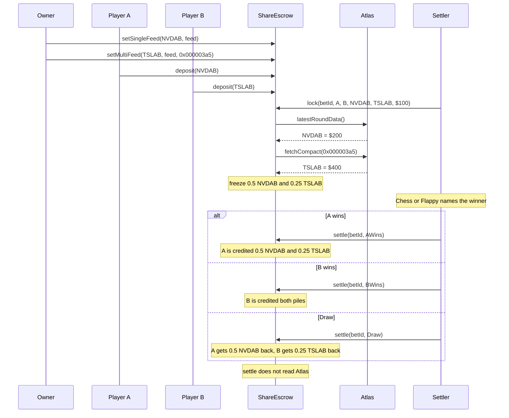

# Connect

Connect p2p games inside agentic sessions.



## Share stakes

Each player deposits the share token they prefer into `ShareEscrow`. Both sides name the same dollar size. Atlas decides how many shares that dollar size is. Chess or Flappy decides who receives both piles.


### Which share

The relay names each player's asset before `lock`. A wallet can hold many shares, more than four or five, and the escrow keeps a free balance for each one. At lock time the relay quotes every share in that wallet, in batches, and asks Cournot whether each covering share finishes down over the next 24 hours. That book lean is read beside CoinMarketCap Fear and Greed. When those two lean the same way, the lock takes the lowest 24-hour change that covers the stake. When they lean apart, the lock takes the highest. The same change breaks by token address. A player who holds no covering share locks native BNB or USDT instead, and the other player can still lock a share. `lock` asks Atlas for every side, including BNB and USDT, and sizes each pile to the same dollar amount. The CoinMarketCap key stays in the relay environment. It is not in the extension or the web page.



### Atlas workflow

`lock` is the only call that reads Atlas. A SingleFeed answers through `latestRoundData()`. A MultiFeed id answers through `fetchCompact` and [`FeedCodec.decode`](https://github.com/oracle-atlas/push-oracle-interfaces/blob/main/src/libraries/FeedCodec.sol). A zero answer, or an update older than `maxPriceAge`, reverts. The share count for each side is `usdStake * 10^tokenDecimals / (price * 10^(18 - priceDecimals))`.



Each player can lock a different stock. Atlas sizes both piles to the same dollar amount. Chess or Flappy names the winner, and `settle` pays both piles from that result without reading Atlas again.

Nvidia against Tesla is the clip example. Each side stakes $100. Player A locks Nvidia at $200 → 0.5 NVDAB. Player B locks Tesla at $400 → 0.25 TSLAB. Those piles are the same $100.


### Live NVDAB vs XAUt on BSC testnet

The deployed escrow is [`0xda4c60592E42DCC2AED553c38D1F8B517d89e3c7`](https://testnet.bscscan.com/address/0xda4c60592E42DCC2AED553c38D1F8B517d89e3c7) ([Sourcify](https://repo.sourcify.dev/contracts/full_match/97/0xda4c60592E42DCC2AED553c38D1F8B517d89e3c7/)). Player A held NVDAB only. Player B held XAUt only. Both sides locked **$1**. Atlas priced NVDAB at **$150.9896** and XAUt at **$3563.3091**, so the escrow froze **0.00662297 NVDAB** and **0.00028064 XAUt**. A won the match, so `settle` credited both piles to A.

| | |
|---|---|
| betId | `0x242dacb2fd43320c626005ebe7f9f4c8aef45b918dc83f3376706b761464def6` |
| Player A (NVDAB) | [`0xC144dEB94B6E27d903d4D0931A09A40A04f4A113`](https://testnet.bscscan.com/address/0xC144dEB94B6E27d903d4D0931A09A40A04f4A113) |
| Player B (XAUt) | [`0x5278754c5d899B646a15f9BC481989272bA50B68`](https://testnet.bscscan.com/address/0x5278754c5d899B646a15f9BC481989272bA50B68) |
| [`lock`](https://testnet.bscscan.com/tx/0x614e3670741c5433be109ac91b4280105d0655dea0da5baf28ed9b1592da5ab7) | block 144992414 · `Locked` · stakeA 6622971130203664 · stakeB 280638017998441 · priceA 150989635971619999510 · priceB 3563309088099219497900 |
| [`settle`](https://testnet.bscscan.com/tx/0x3916c65ad6d812be0b4a4c942db20671c07349366008f98678647189ab823ad8) | block 144992825 · `Settled(AWins)` · A credited both frozen piles |

```text
lock  0x614e3670741c5433be109ac91b4280105d0655dea0da5baf28ed9b1592da5ab7
      Locked(betId, A, B, NVDAB, XAUt, 0.00662297e18, 0.00028064e18, $150.9896e18, $3563.3091e18)

settle 0x3916c65ad6d812be0b4a4c942db20671c07349366008f98678647189ab823ad8
      Settled(betId, AWins, stakeA, stakeB)
      A free balance += stakeA NVDAB + stakeB XAUt
```

Feeds, the earlier deploy deposits, and the fork command are in [contracts/README.md](contracts/README.md#shareescrow).

```bash
pnpm test:contracts:share:fork
```

## Relay living brain


