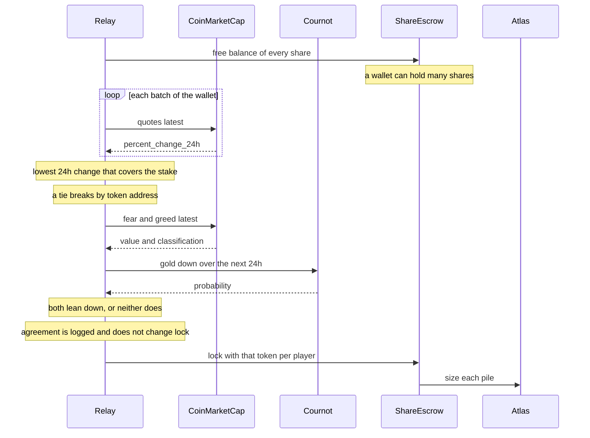
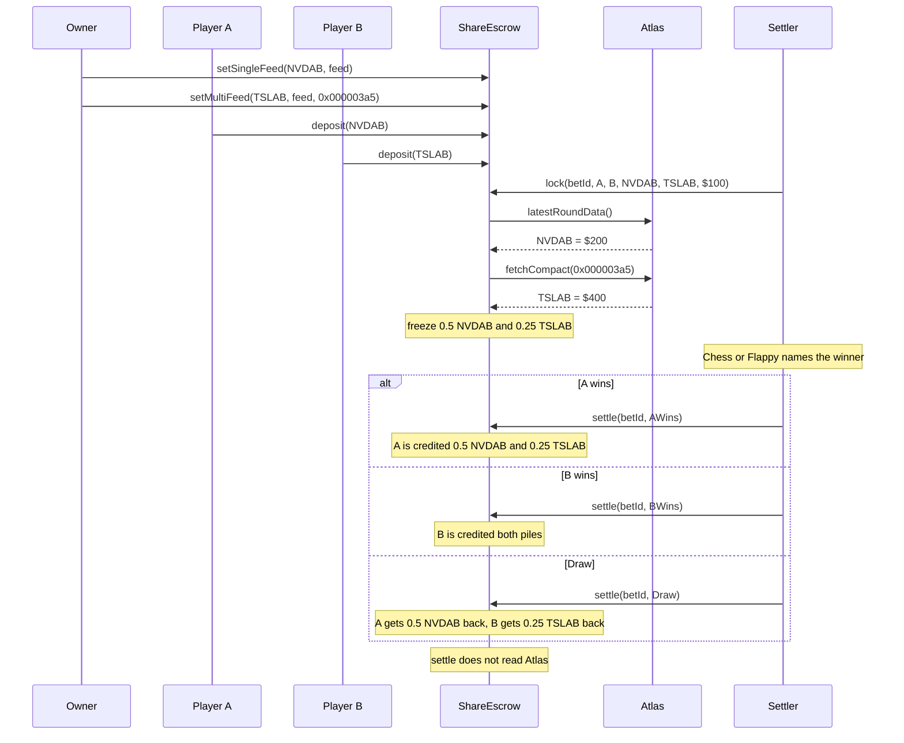

# Connect

Connect p2p games inside agentic sessions.

## Share stakes

Each player deposits the share token they prefer into `ShareEscrow`. Both sides name the same dollar size. Atlas decides how many shares that dollar size is. Chess or Flappy decides who receives both piles.

### Which share

The relay names each player's asset before `lock`. A wallet can hold many shares, more than four or five, and the escrow keeps a free balance for each one. The relay quotes every share in that wallet, in batches, and locks the share with the lowest 24-hour change that can cover the stake. The same change breaks by token address. A player who holds no share locks native BNB or USDT instead, and the other player can still lock a share. On startup the relay reads Cournot's gold-down probability beside CoinMarketCap Fear and Greed and logs whether the two lean the same way. That comparison does not choose the share and does not change `lock`. `lock` asks Atlas for every side, including BNB and USDT, and sizes each pile to the same dollar amount. The CoinMarketCap key stays in the relay environment. It is not in the extension or the web page.



### Atlas workflow

`lock` is the only call that reads Atlas. A SingleFeed answers through `latestRoundData()`. A MultiFeed id answers through `fetchCompact` and [`FeedCodec.decode`](https://github.com/oracle-atlas/push-oracle-interfaces/blob/main/src/libraries/FeedCodec.sol). A zero answer, or an update older than `maxPriceAge`, reverts. The share count for each side is `usdStake * 10^tokenDecimals / (price * 10^(18 - priceDecimals))`.



Nvidia against Tesla is one way to use it. In the clip each side stakes $100. Player A locks Nvidia: the feed is $200, so the escrow freezes 0.5 NVDAB. Player B locks Tesla: the feed is $400, so it freezes 0.25 TSLAB. Those piles are the same $100, and Chess or Flappy settles them.


On BSC testnet the live proof uses the NVDAB/USD, XAU/USD, and BNB/USD SingleFeeds. Those addresses are price feeds, so the test mints stand-in NVDAB and XAUt piles and registers them against the feeds. The deployed escrow is [`0xda4c60592E42DCC2AED553c38D1F8B517d89e3c7`](https://testnet.bscscan.com/address/0xda4c60592E42DCC2AED553c38D1F8B517d89e3c7), and the [source matches the bytecode](https://repo.sourcify.dev/contracts/full_match/97/0xda4c60592E42DCC2AED553c38D1F8B517d89e3c7/).

The local fork reads those same feeds and does not broadcast:

```bash
pnpm test:contracts:share:fork
```

Feeds, the `lock` and `settle` transactions, and the fork command are in [contracts/README.md](contracts/README.md#shareescrow).
