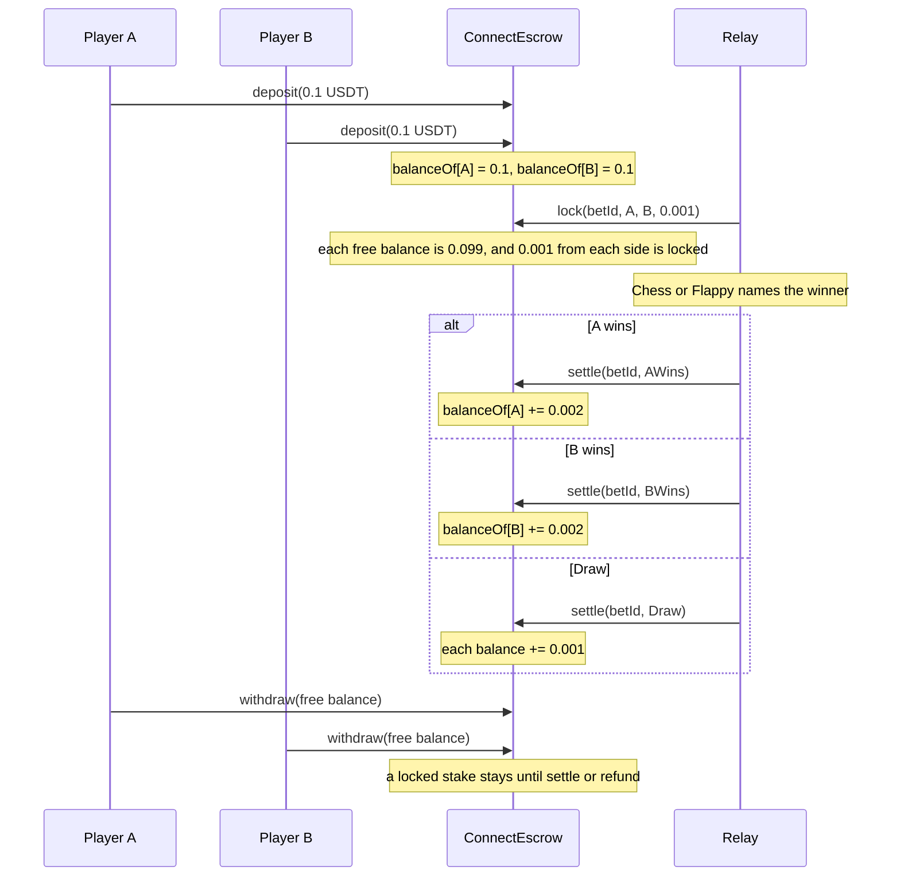
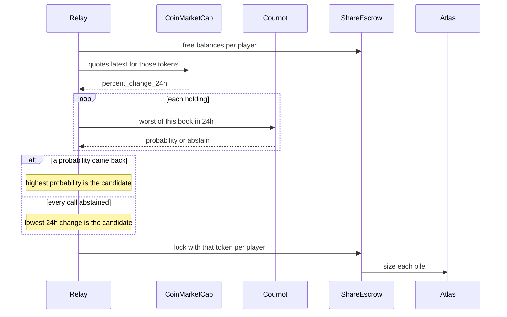
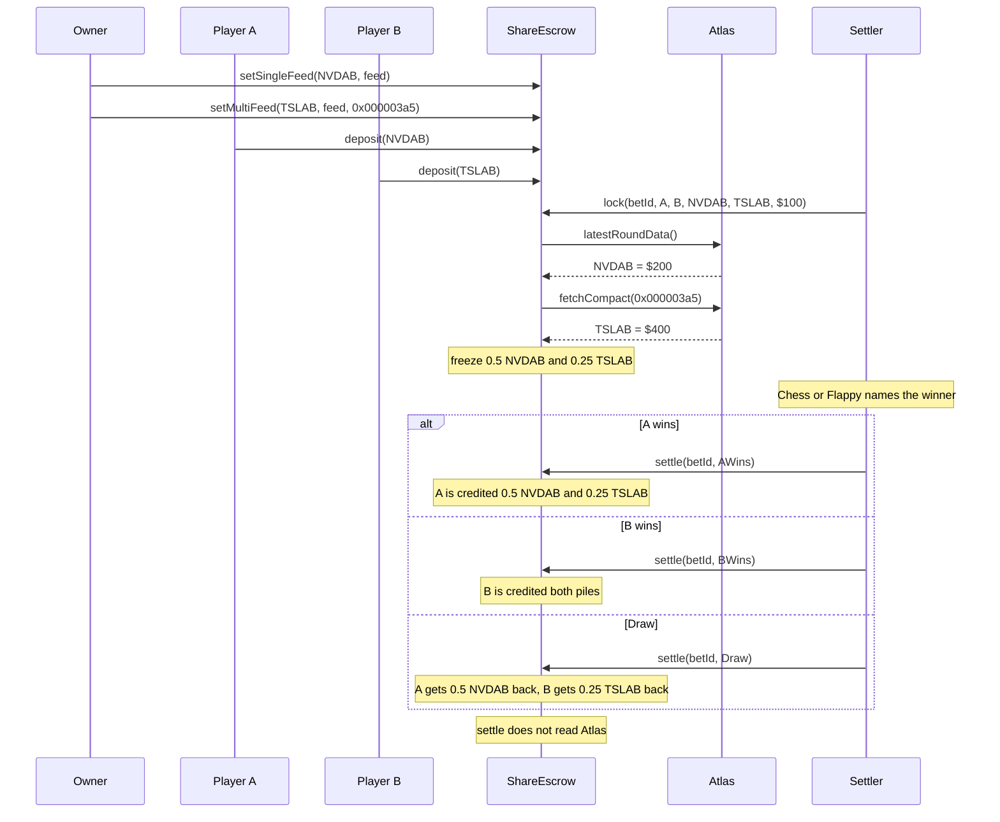

# Connect

Two players deposit USDT once into `ConnectEscrow`. The relay locks a stake for each match, decides the winner, and the contract pays that player's balance.



The contract and the testnet record are in [contracts/README.md](contracts/README.md). The relay is `relay/`.

```bash
pnpm install
pnpm --filter @connect/relay test
pnpm --filter @connect/relay dev
```

On BSC testnet a deposit is 0.1 USDT and a match locks 0.001 USDT. Set `CONNECT_ESCROW_ADDRESS`, `CONNECT_ESCROW_CHAIN_ID=97`, and `ESCROW_SETTLER_PRIVATE_KEY` before starting the relay. See `.env.example`.

## Share stakes

`ShareEscrow` is separate from the USDT escrow. Each player deposits the share token they prefer. Both sides name the same dollar size. Atlas decides how many shares that dollar size is. Chess or Flappy decides who receives both piles.

### Which share

The relay names each player's token before `lock`. It reads that player's free balances, asks CoinMarketCap for each holding's 24-hour change, and asks Cournot which holding is most likely to be the worst of that book over the next 24 hours. The highest probability is the token. If every Cournot call abstains, the lowest 24-hour change is the token. `lock` then asks Atlas to size the pile. The CoinMarketCap key stays in the relay environment. It is not in the extension or the web page.



### Atlas workflow

`lock` is the only call that reads Atlas. A SingleFeed answers through `latestRoundData()`. A MultiFeed id answers through `fetchCompact` and [`FeedCodec.decode`](https://github.com/oracle-atlas/push-oracle-interfaces/blob/main/src/libraries/FeedCodec.sol). A zero answer, or an update older than `maxPriceAge`, reverts. The share count for each side is `usdStake * 10^tokenDecimals / (price * 10^(18 - priceDecimals))`.



Nvidia against Tesla is one way to use it. In the clip each side stakes $100. Player A locks Nvidia: the feed is $200, so the escrow freezes 0.5 NVDAB. Player B locks Tesla: the feed is $400, so it freezes 0.25 TSLAB. Those piles are the same $100, and Chess or Flappy settles them.


On BSC testnet the live proof uses the NVDAB/USD and XAU/USD SingleFeeds. Those addresses are price feeds, so the test mints stand-in NVDAB and XAUt piles and registers them against the feeds. The deployed escrow is [`0xEB8B7C5105D95E08c09fcf067936e44222BF2A59`](https://testnet.bscscan.com/address/0xEB8B7C5105D95E08c09fcf067936e44222BF2A59), and the [source matches the bytecode](https://repo.sourcify.dev/contracts/full_match/97/0xEB8B7C5105D95E08c09fcf067936e44222BF2A59/).

The local fork reads those same feeds and does not broadcast:

```bash
pnpm test:contracts:share:fork
```

Feeds, the `lock` and `settle` transactions, and the fork command are in [contracts/README.md](contracts/README.md#shareescrow).
