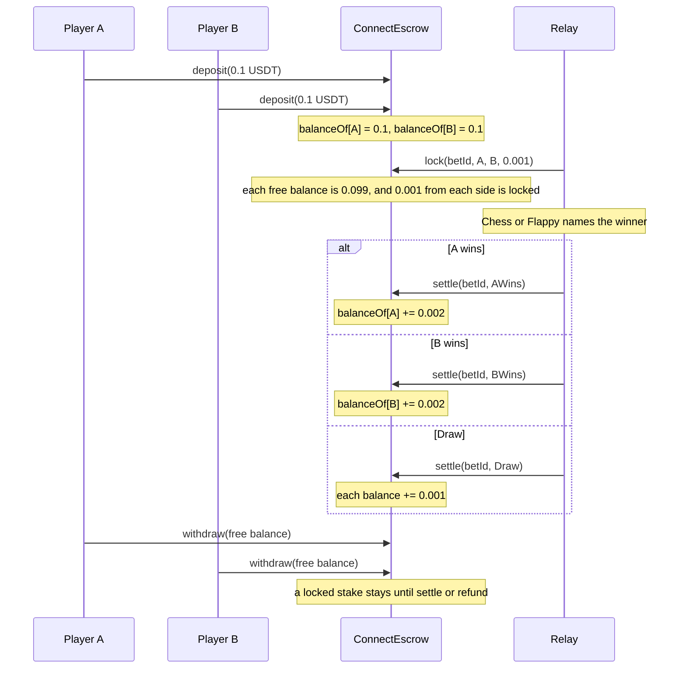
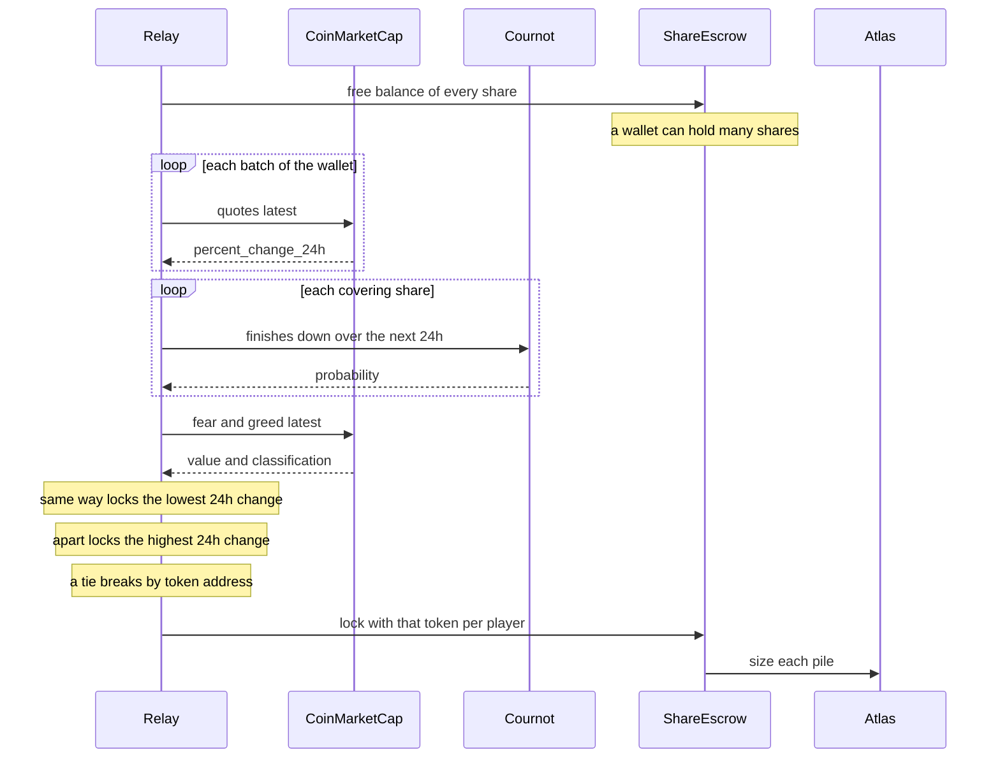
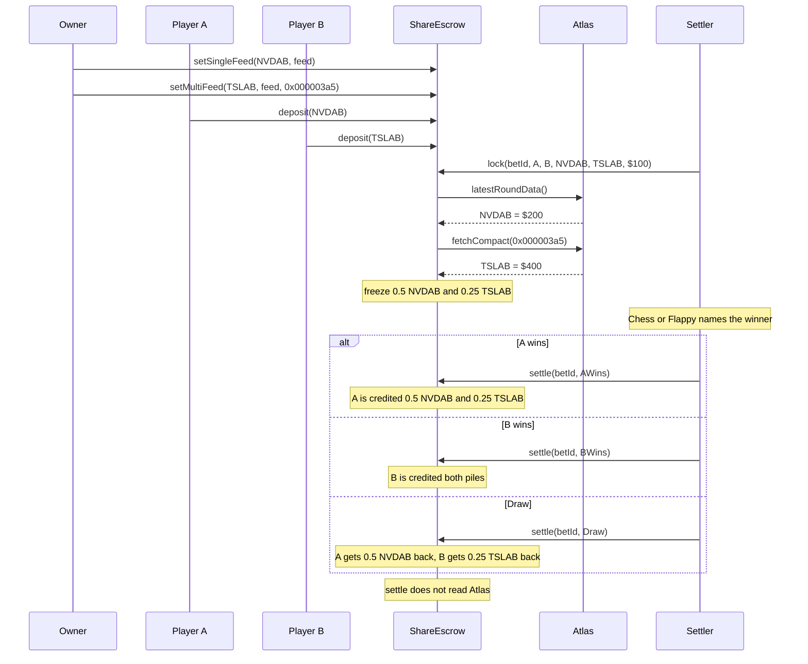

# ConnectEscrow

One contract on BNB Chain holds a USDT balance per player. A player deposits once. Each chess or Flappy match locks a stake from that balance. The relay reports the winner, and the contract adds the pot to that player's balance.



On BSC testnet the deposit is 0.1 USDT and the stake is 0.001 USDT. Both use 18 decimals.

## BSC testnet (chain id 97)

| | Address |
|---|---|
| ConnectEscrow | [`0x2c77532f9b5E32D0E5f5BF2AF3B1B0b3484F3E54`](https://testnet.bscscan.com/address/0x2c77532f9b5E32D0E5f5BF2AF3B1B0b3484F3E54) |
| MockUSDT | [`0x27Ae80b8eE17ffbCFCf38469A018A942BC8f8Ba9`](https://testnet.bscscan.com/address/0x27Ae80b8eE17ffbCFCf38469A018A942BC8f8Ba9) |
| Settler | [`0xC04F807aC5D7963055e8827EAc37350703afdCfC`](https://testnet.bscscan.com/address/0xC04F807aC5D7963055e8827EAc37350703afdCfC) |

Source matches the deployed bytecode:

- [ConnectEscrow on Sourcify](https://repo.sourcify.dev/contracts/full_match/97/0x2c77532f9b5E32D0E5f5BF2AF3B1B0b3484F3E54/)
- [MockUSDT on Sourcify](https://repo.sourcify.dev/contracts/full_match/97/0x27Ae80b8eE17ffbCFCf38469A018A942BC8f8Ba9/)

### Transactions

- [Deploy MockUSDT](https://testnet.bscscan.com/tx/0x82873066029e32714a8beb109174bcbcb0e3d3411fc67074ddb095564da108cd)
- [Deploy ConnectEscrow](https://testnet.bscscan.com/tx/0x7b50648f956f36040416eb0b672af0cd4ab7772203d276e474af89c2235f32ac)
- [Mint 0.1 USDT to player A](https://testnet.bscscan.com/tx/0x4db63352d78b587bbfd870bb53245e21ea074c34e3ccfdfc7c0bb07939bbe811)
- [Mint 0.1 USDT to player B](https://testnet.bscscan.com/tx/0xc9158c487c5f0b9585632137447c0d8882e866a9db4244f2bcac9b6be8831250)
- [Player A wins 0.001](https://testnet.bscscan.com/tx/0x22a4d4b6d694cd86b64334f2c28d8bebe37e6c3bd2ccb8535a029514f100a555)
- [Player B wins 0.001](https://testnet.bscscan.com/tx/0x7185eb8e191c220932f3e17db2018a7f29d45dffb2c7dd27b6f296ce9493cff2)

Player A is `0xC144dEB94B6E27d903d4D0931A09A40A04f4A113`. Player B is `0x5278754c5d899B646a15f9BC481989272bA50B68`. After both results, each escrow balance is 0.1 USDT again.

## Tests

Install Foundry libraries once:

```bash
forge install foundry-rs/forge-std OpenZeppelin/openzeppelin-contracts oracle-atlas/push-oracle-interfaces --no-git
```

```bash
# Local escrow cases: one 0.1 deposit covers two 0.001 bets
forge test --match-path test/ConnectEscrow.t.sol

# Same flow on a BSC testnet fork. No faucet and no broadcast.
forge test --match-path test/ConnectEscrow.fork.t.sol -vv
```

From the repo root, `pnpm test:contracts` and `pnpm test:contracts:fork` run those two suites. The relay suite is `pnpm --filter @connect/relay test`. The crossed-stock fork is below.

## ShareEscrow

Each player deposits the share token they want to stake. A match locks one pile from each player. The tokens can differ. Both sides pass the same dollar size. Atlas is read only at `lock`. `settle` pays the stored counts from the match outcome and does not read the feed again. The winner receives both piles. A draw returns each pile.

### Which share

The relay names each player's asset before `lock`. A wallet can hold many shares, more than four or five, and the escrow keeps a free balance for each one. At lock time the relay quotes every share in that wallet, in batches, and asks Cournot whether each covering share finishes down over the next 24 hours. That book lean is read beside CoinMarketCap Fear and Greed. When those two lean the same way, the lock takes the lowest 24-hour change that covers the stake. When they lean apart, the lock takes the highest. The same change breaks by token address. A player who holds no covering share locks native BNB or USDT instead, and the other player can still lock a share. `lock` asks Atlas for every side, including BNB and USDT, and sizes each pile to the same dollar amount. Native BNB is `address(0)`. The CoinMarketCap key stays in the relay environment. It is not in the extension or the web page.



### Atlas workflow

`lock` is the only call that reads Atlas. A SingleFeed answers through `latestRoundData()`. A MultiFeed id answers through `fetchCompact` and [`FeedCodec.decode`](https://github.com/oracle-atlas/push-oracle-interfaces/blob/main/src/libraries/FeedCodec.sol). A zero answer, an empty MultiFeed word, or an update older than `maxPriceAge` reverts. The share count for each side is `usdStake * 10^tokenDecimals / (price * 10^(18 - priceDecimals))`. The fork test and the testnet deploy set `maxPriceAge` to 3 days. A second `settle` reverts.



Nvidia against Tesla is the example in the clip. The same calls work for any pair of registered assets, including native BNB. On BSC testnet the registered feeds are NVDAB/USD, XAU/USD, and BNB/USD, all SingleFeeds.


[MP4](docs/share-escrow-flow.mp4), 48 seconds.

In the clip each side stakes $100. Player A locks Nvidia. The SingleFeed answers $200, so the escrow freezes 0.5 NVDAB. Player B locks Tesla. The MultiFeed answers $400, so it freezes 0.25 TSLAB. Both piles are worth $100.

| Step | Call | Result |
|---|---|---|
| Register | `setSingleFeed(NVDAB, feed)` and `setMultiFeed(TSLAB, feed, 0x000003a5)` | Owner points each token at its Atlas feed |
| Deposit | `deposit` | A deposits their Nvidia shares, B deposits their Tesla shares |
| Lock | `lock(betId, A, B, NVDAB, TSLAB, $100)` | Escrow reads both feeds and freezes equivalent $100 piles |
| Play | Chess or Flappy | The match names the winner |
| A wins | `settle(betId, AWins)` | A receives 0.5 NVDAB and 0.25 TSLAB |
| B wins | `settle(betId, BWins)` | B receives both piles |
| Draw | `settle(betId, Draw)` | A gets 0.5 NVDAB back, B gets 0.25 TSLAB back |

### BSC testnet feeds the fork reads

Atlas published these as SingleFeeds. `description()` returns the pair. They are the price source, and the test mints the NVDAB and XAUt piles that get locked.

| | Address |
|---|---|
| NVDAB/USD | [`0x3eF39d6361EfA1E8Ca066751f438077dA81082A6`](https://testnet.bscscan.com/address/0x3eF39d6361EfA1E8Ca066751f438077dA81082A6) |
| XAU/USD | [`0xB3C87F255CE00b2692dc0eaf3e5985fBe2489764`](https://testnet.bscscan.com/address/0xB3C87F255CE00b2692dc0eaf3e5985fBe2489764) |
| BNB/USD | [`0x3957d289ee9C38272377786787ea34F9dd29788D`](https://testnet.bscscan.com/address/0x3957d289ee9C38272377786787ea34F9dd29788D) |

### Run the fork locally

Foundry forks BSC testnet (chain id 97), deploys `ShareEscrow` on that fork, and runs deposit, lock, and settle against the live feeds. Nothing is broadcast.

```bash
pnpm test:contracts:share:fork
```

From `contracts/`:

```bash
forge test --match-path test/ShareEscrow.fork.t.sol -vv
```

`testFork_liveFeedsSizeThePilesAndWinnerTakesBoth` quotes both feeds, deposits those share counts, locks $1 per side, and checks the stored prices and counts. After `settle(betId, AWins)`, A withdraws both tokens. A second settle reverts. Override the RPC with `BSC_TESTNET_RPC` when the default public node is unavailable.

### Broadcast on BSC testnet

`script/SimulateShareEscrowTestnet.s.sol` deployed the escrow, minted the two piles, registered the NVDAB, XAU, and native BNB feeds, and ran one $1 match. Player A deposited 1 NVDAB and player B deposited 1 XAUt. Player A won.

| | Address |
|---|---|
| ShareEscrow | [`0xda4c60592E42DCC2AED553c38D1F8B517d89e3c7`](https://testnet.bscscan.com/address/0xda4c60592E42DCC2AED553c38D1F8B517d89e3c7) |
| NVDAB pile | [`0x876904e7b854f17A5582524aa5028124240f0e8E`](https://testnet.bscscan.com/address/0x876904e7b854f17A5582524aa5028124240f0e8E) |
| XAUt pile | [`0x73888097E35C7105aE80022ae2A8beaAc1435E73`](https://testnet.bscscan.com/address/0x73888097E35C7105aE80022ae2A8beaAc1435E73) |

Source matches the deployed bytecode:

- [ShareEscrow on Sourcify](https://repo.sourcify.dev/contracts/full_match/97/0xda4c60592E42DCC2AED553c38D1F8B517d89e3c7/)
- [NVDAB pile on Sourcify](https://repo.sourcify.dev/contracts/full_match/97/0x876904e7b854f17A5582524aa5028124240f0e8E/)
- [XAUt pile on Sourcify](https://repo.sourcify.dev/contracts/full_match/97/0x73888097E35C7105aE80022ae2A8beaAc1435E73/)

Each player can hold a different stock. Atlas sizes both piles to the same dollar stake. The game result pays both piles; `settle` does not reread Atlas.

[A deposited 1 NVDAB](https://testnet.bscscan.com/tx/0x2242b8e5f1f57c2104f3d4faeeca0a6ef03f86eef8294321f54310bdc27c5d4b) and [B deposited 1 XAUt](https://testnet.bscscan.com/tx/0x22d1636a901e6a68b54fc75e1b584a886441616265c91fc332d15e9fa63a54ef). A later cross-stock match reused those free balances: A locked NVDAB only, B locked XAUt only, both at **$1**.

| | |
|---|---|
| betId | `0x242dacb2fd43320c626005ebe7f9f4c8aef45b918dc83f3376706b761464def6` |
| Player A | [`0xC144dEB94B6E27d903d4D0931A09A40A04f4A113`](https://testnet.bscscan.com/address/0xC144dEB94B6E27d903d4D0931A09A40A04f4A113) |
| Player B | [`0x5278754c5d899B646a15f9BC481989272bA50B68`](https://testnet.bscscan.com/address/0x5278754c5d899B646a15f9BC481989272bA50B68) |
| [`lock`](https://testnet.bscscan.com/tx/0x614e3670741c5433be109ac91b4280105d0655dea0da5baf28ed9b1592da5ab7) | block 144992414 · `Locked` · 0.006622971130203664 NVDAB at $150.989635971619999510 · 0.000280638017998441 XAUt at $3563.309088099219497900 |
| [`settle`](https://testnet.bscscan.com/tx/0x3916c65ad6d812be0b4a4c942db20671c07349366008f98678647189ab823ad8) | block 144992825 · `Settled(AWins)` · A credited both frozen piles |

```text
Locked(
  betId  0x242dacb2fd43320c626005ebe7f9f4c8aef45b918dc83f3376706b761464def6,
  A      0xC144…A113,
  B      0x5278…0B68,
  tokenA NVDAB,
  tokenB XAUt,
  stakeA 6622971130203664,
  stakeB 280638017998441,
  priceA 150989635971619999510,
  priceB 3563309088099219497900
)

Settled(betId, AWins, stakeA, stakeB)
A free balance += stakeA NVDAB + stakeB XAUt
```

## Deploy again

`ESCROW_SETTLER` is the address allowed to `lock` and `settle`. The key stays in the environment, not in git.

```bash
forge script script/DeployConnectEscrowTestnet.s.sol:DeployConnectEscrowTestnet \
  --rpc-url "$BNB_RPC_URL" \
  --private-key "$ESCROW_SETTLER_PRIVATE_KEY" \
  --broadcast \
  --legacy
```
